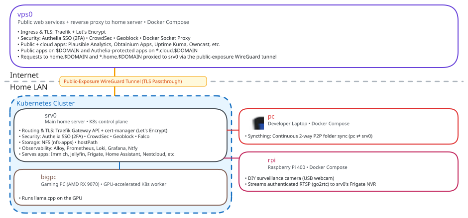

# Infra

The IaC system for my homelab and other devices.

Targets, request paths, and design goals: [Architecture](docs/architecture.md).

  

Docs index: [docs/README.md](docs/README.md). Rulebook: [AGENTS.md](AGENTS.md).
First boot and deploy: [Operations](docs/operations.md#first-boot).

Note that while LLMs are used in development, the LLM isn't the one putting its data
on the line. [It is just a tool](https://www.normaltech.ai/p/ai-as-normal-technology)
and is used like one.
