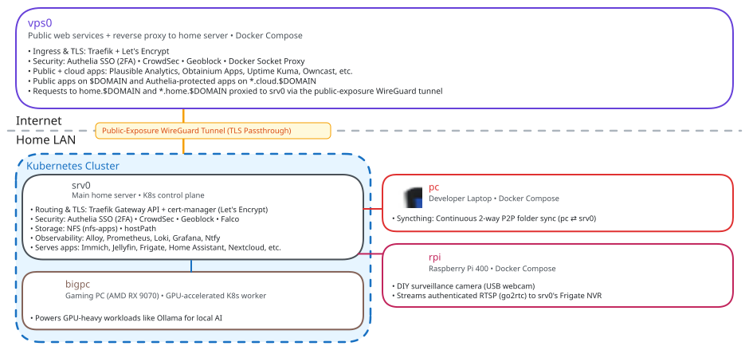

# Infra

The IaC system for my homelab and other devices.

## Architecture

- `vps0` is a cloud VPS that uses Docker Compose to run public-facing services like [`apps.obtainium.imranr.dev`](https://apps.obtainium.imranr.dev/) and tunnel some requests through to `srv0`.
- `srv0` is a lightweight home server that uses Kubernetes (K3s) to run personal services like [Immich](https://immich.app/).
- `bigpc` is a gaming PC that also serves as a Kubernetes worker node for GPU-accelerated workloads like [Ollama](https://ollama.com/).
- `pc` is a laptop that runs [Syncthing](https://syncthing.net/) (via Docker Compose) to sync files to `srv0`.
- `rpi` is an SBC that streams a live camera feed to [Frigate](https://frigate.video/) on `srv0`.

<p align="center">
  
</p>

## Project Goals

- **Infrastructure as Code**: Everything should be declarative and automated, using standard tooling wherever possible. Custom scripts should be minimal and only where necessary.
- **Security**: As the codebase is public and the system runs public-facing services containing highly personal data, security must be taken seriously. To that end:
  - **[Authelia](https://www.authelia.com/) SSO** guards every service that needs it.
  - **[CrowdSec](https://www.crowdsec.net/) automated threat response** guards all public services.
  - **Geoblocking** is used for services that do not need to be globally accessible.
  - **Network policies** are used in the `srv0` Kubernetes stack to ensure that pod-to-pod communication is only allowed where necessary.
  - **WireGuard key pairs** (as opposed to symmetric token-based encryption) protect the public-exposure tunnel between `srv0` and `vps0`; each peer authenticates with its own key, preventing certain kinds of MITM attacks.
  - **The Principle of Least Privilege** is applied to containers, with elevated privileges and root runtime user only allowed where necessary. Host devices are granted as Kubernetes device-plugin resources (via the generic-device-plugin) rather than `privileged: true`.
  - **Comprehensive Monitoring and Alerting** is done using [Alloy](https://grafana.com/docs/alloy/) + [Prometheus](https://prometheus.io/), [Loki](https://grafana.com/docs/loki/latest/), [Grafana](https://grafana.com/), [Ntfy.sh](https://ntfy.sh/) + [Logtfy](https://github.com/ImranR98/Logtfy), [Headlamp](https://headlamp.dev/), [Dozzle](https://dozzle.dev/), and [Uptime Kuma](https://github.com/louislam/uptime-kuma).
  - **[Falco](https://falco.org/)** flags suspicious activity on K3s nodes.
  - **A Honeypot ([Opencanary](https://github.com/thinkst/opencanary))** is used to discover intruders.
  - **Regular update checking** is done via [Renovate](https://www.mend.io/renovate/): a six-hourly Renovate-only run opens PRs and auto-merges non-major app updates after their test gate, while every Infra digest/chart PR is a manual rollout gate.

## Usage examples

```bash
# Install prerequisites on every machine
bash scripts/prereqs.sh

# Create the gitignored config tree (never overwrites existing files).
# On srv0, --detect fills MY_UID/GPU_PROFILE/HA_CONBEE/HA_BLUETOOTH.
bash scripts/init-config.sh srv0 --detect
bash scripts/init-config.sh vps0

# Fill config/VARS.env, values/compose envs, Authelia users/rules, and the
# optional vps0 agent config. The explorer Configuration tour covers the full surface.
bash scripts/validate.sh srv0
bash scripts/validate.sh vps0

# Deploy one target; srv0 uses Helm, the rest use the Compose wrapper.
bash scripts/deploy.sh srv0
bash scripts/deploy.sh vps0
bash scripts/deploy.sh pc

# Or run Compose directly through the wrapper (env files, machine facts,
# private overlay, profiles, and vps0 Authelia render are automatic).
bash scripts/compose.sh vps0 up -d
bash scripts/compose.sh vps0 logs -f authelia

# Run Renovate manually (the in-cluster jobs do this on a schedule) — machine-local
bash scripts/renovate.sh [apps|infra|all|clear-cache] [--dry-run]
```

## Guided documentation

The architecture, request path, public edge, WireGuard, apps/data, operations, configuration, first boot, and maintenance walkthroughs live in the guided explorer app in `explorer/`. It requires Node.js 18+ and npm.

```bash
cd explorer
npm install   # first run only
npm run dev
```

Open <http://localhost:4173/>. For a production build:

```bash
npm run build
npm run preview
```

The explorer is the documentation for this repo; `AGENTS.md` remains the contributor/operations guide.

## More

The guided explorer is the documentation: start with the **Start here** tour, then use the topic tours for the public edge, WireGuard, apps/data, operations, configuration/decisions, first boot, and maintenance. Contributor and agent rules remain in [AGENTS.md](AGENTS.md).

Note that while LLMs are used in development, the LLM isn't the one putting its data on the line. [It is just a tool](https://www.normaltech.ai/p/ai-as-normal-technology) and is used like one.
