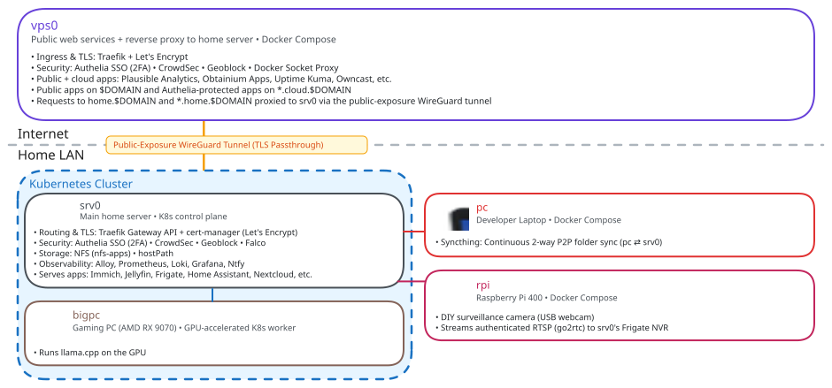

# Infra

The IaC system for my homelab and other devices.

## Architecture

- `vps0` is a cloud VPS that uses Docker Compose to run public-facing services like [`apps.obtainium.imranr.dev`](https://apps.obtainium.imranr.dev/) and tunnel some requests through to `srv0`.
- `srv0` is a lightweight home server that uses Kubernetes (K3s) to run personal services like [Immich](https://immich.app/). Other worker K8s nodes exist but are not explicitly mentioned (so "K8s cluster" and `srv0` are generally interchangeable in the docs).
- `bigpc` is a gaming PC that runs llama.cpp in Docker Compose on its AMD RX 9070 (ROCm), exposed via `srv0`.
- `pc` is a laptop that runs [Syncthing](https://syncthing.net/) (via Docker Compose) to sync files to `srv0`.
- `rpi` is an SBC that streams a live camera feed to [Frigate](https://frigate.video/) on `srv0`.

<p align="center">
  
</p>

## Project Goals

- **Infrastructure as Code**: Everything should be declarative and automated, using standard tooling wherever possible. Custom scripts should be minimal and only where necessary.
- **Security**: As the codebase is public and the system runs public-facing services containing highly personal data, security must be taken seriously. To that end:
  - **[Authelia](https://www.authelia.com/) SSO** guards every service that needs it.
  - **[CrowdSec](https://www.crowdsec.net/) automated threat response** guards all public services.
  - **Geoblocking** is used for services that do not need to be globally accessible.
  - **Network policies** are used in the `srv0` Kubernetes stack to ensure that pod-to-pod communication is only allowed where necessary.
  - **WireGuard key pairs** (as opposed to symmetric token-based encryption) protect the public-exposure tunnel between `srv0` and `vps0`; each peer authenticates with its own key, preventing certain kinds of MITM attacks.
  - **The Principle of Least Privilege** is applied to containers, with elevated privileges and root runtime user only allowed where necessary. Host devices are granted as Kubernetes device-plugin resources (via the generic-device-plugin) rather than `privileged: true`.
  - **Comprehensive Monitoring and Alerting** is done using [Alloy](https://grafana.com/docs/alloy/) + [Prometheus](https://prometheus.io/), [Loki](https://grafana.com/docs/loki/latest/), [Grafana](https://grafana.com/), [Ntfy.sh](https://ntfy.sh/) + [Logtfy](https://github.com/ImranR98/Logtfy), [Headlamp](https://headlamp.dev/), [Dozzle](https://dozzle.dev/), [Uptime Kuma](https://github.com/louislam/uptime-kuma), and [Falco](https://falco.org/).
  - **A Honeypot ([Opencanary](https://github.com/thinkst/opencanary))** is used to discover intruders.
  - **Regular update checking** is done via [Renovate](https://www.mend.io/renovate/): a six-hourly Renovate-only run opens PRs and auto-merges non-major app updates after their test gate, while every Infra digest/chart PR is a manual rollout gate.

## Usage examples

```bash
# Install prerequisites on every machine
bash scripts/prereqs.sh

# Create the gitignored config tree (never overwrites existing files).
# On srv0, --detect fills MY_UID/GPU_PROFILE/HA_CONBEE/HA_BLUETOOTH.
bash scripts/init-config.sh srv0 --detect
bash scripts/init-config.sh vps0

# Fill config/VARS.env, values/compose envs, Authelia users/rules, and the
# optional vps0 agent config. The explorer Configuration tour covers the full surface.
bash scripts/validate.sh srv0
bash scripts/validate.sh vps0

# Deploy — validate.sh is read-only and must run before every deploy.
# Copy-paste commands for Compose targets and srv0 are in "Deploy" below.

# Run Renovate manually (the in-cluster jobs do this on a schedule) — machine-local
bash scripts/renovate.sh [apps|infra|all|clear-cache] [--dry-run]
```

## Deploy

Run these on the target machine, in its repo checkout. `bash scripts/prereqs.sh`
must have run there once: it writes the machine-fact
`targets/<t>/compose/.env` and creates `~/infra_state/`.

`docker compose` needs `sudo` on these machines; `validate.sh` and the Helm
commands do not.

### vps0, pc, bigpc, rpi — Compose

```bash
bash scripts/validate.sh vps0

# vps0 only: regenerate the Authelia config from config/vps0/authelia/.
bash scripts/render-vps0-authelia.sh

sudo docker compose \
  --env-file config/vps0/compose.env \
  -f targets/vps0/compose/compose.yaml \
  -f targets/vps0/compose/compose.private.yaml \
  --env-file targets/vps0/compose/.env \
  up -d --remove-orphans
```

For `pc`, `bigpc`, and `rpi`, use their own path and drop the
`compose.private.yaml` line. `srv0`'s Compose sidecar (the public-exposure
client) uses `config/srv0/compose.env` and
`targets/srv0/compose/compose.yaml`.

Repeat the same flags for every other Compose command — `ps`, `logs -f <svc>`,
`down <svc>`, `up -d --force-recreate --no-deps <svc>`:

```bash
sudo docker compose \
  --env-file config/vps0/compose.env \
  -f targets/vps0/compose/compose.yaml \
  -f targets/vps0/compose/compose.private.yaml \
  --env-file targets/vps0/compose/.env \
  ps
```

Why each flag:

- `--env-file config/<t>/compose.env` — the target's VARS and secrets. Without
  it the `${VAR:?}` guards abort and optional vars interpolate empty.
- `--env-file targets/<t>/compose/.env` — generated machine facts (`MY_UID`,
  `DOCKER_GID`, `MY_USERNAME`, `COMPOSE_STATE_DIR`). Without it containers run
  as root and bind mounts end up root-owned. This file also carries
  `COMPOSE_PROFILES`, so no `--profile` flag is needed.
- Passing any `--env-file` disables Compose's `.env` auto-discovery, which is
  why the machine-fact file is passed explicitly.
- `--remove-orphans` drops containers for services removed from the file.

Keep the flags explicit: `sudo` strips exported variables, so shortcuts like
`COMPOSE_FILE`/`COMPOSE_ENV_FILES` (or a shell alias) do not survive.

### srv0 — K3s

```bash
# Terminal 1, for the whole session (the admin kubeconfig is root-only):
bash scripts/kubeconfig-unlock.sh

# Terminal 2:
bash scripts/validate.sh srv0
helm upgrade --install srv0-base targets/srv0/k3s-base -n base --create-namespace \
  -f targets/srv0/k3s-base/values.yaml -f config/srv0/values.yaml
helm upgrade --install srv0-apps targets/srv0/k3s-apps -n apps --create-namespace \
  -f targets/srv0/k3s-apps/values.yaml -f config/srv0/values.yaml
```

Apply `base` before `apps`; delete in reverse order. `helm` returning success is
not the end: the base chart ships `HelmChart` CRs that k3s's helm-controller
installs asynchronously.

```bash
kubectl -n base get helmcharts
kubectl -n apps get helmcharts
for ns in base apps; do
  kubectl -n "$ns" get deploy,statefulset,daemonset -o name |
    while read -r r; do kubectl -n "$ns" rollout status "$r" --timeout=120s || echo "FAILED: $r"; done
done
kubectl get pods -A --no-headers | grep -vE 'Running|Completed' || echo "pods OK"
kubectl get --raw /readyz
kubectl get events -A --field-selector type=Warning --sort-by=.lastTimestamp | tail -20
```

### Remote machines

`vps0`, `pc`, `bigpc`, and `rpi` deploy from their own checkout, so pull first
and then run the block above on that machine:

```bash
ssh -A <user@host> 'cd <repo path> && git pull --ff-only'
```

## Guided documentation

The architecture, request path, public edge, WireGuard, apps/data, operations, configuration, first boot, and maintenance walkthroughs live in the guided explorer app in `explorer/`. It requires Node.js 18+ and npm.

```bash
cd explorer
npm install   # first run only
npm run dev
```

Open <http://localhost:4173/>. For a production build:

```bash
npm run build
npm run preview
```

The explorer is the documentation for this repo; `AGENTS.md` remains the contributor/operations guide.

## More

The guided explorer is the documentation: start with the **Start here** tour, then use the topic tours for the public edge, WireGuard, apps/data, operations, configuration/decisions, first boot, and maintenance. Contributor and agent rules remain in [AGENTS.md](AGENTS.md).

Note that while LLMs are used in development, the LLM isn't the one putting its data on the line. [It is just a tool](https://www.normaltech.ai/p/ai-as-normal-technology) and is used like one.
