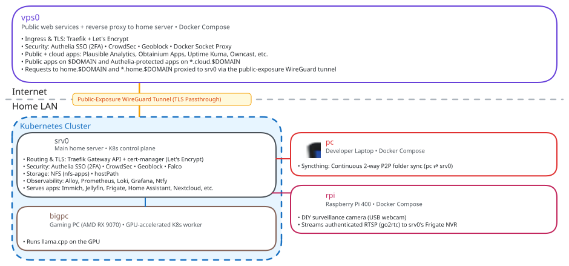

# Architecture

Five machines, two orchestrators, one public edge. `srv0` runs the Kubernetes
workloads; `vps0` is the public entry point; `bigpc`, `pc`, and `rpi` are Compose
satellites.

## Targets

| Target | Role | Orchestrator |
|---|---|---|
| `srv0` | Main server, LUKS-encrypted root, most apps, NFS, observability, security | K3s + Compose sidecar for the public-exposure client |
| `vps0` | Public VPS, Traefik edge, public-exposure hub, public apps | Compose |
| `bigpc` | llama.cpp on the AMD RX 9070 (ROCm), D4TA Wine archive agent, Syncthing | Compose |
| `pc` | llama.cpp on the Intel Arc iGPU (SYCL), Syncthing; optional commented ComfyUI | Compose |
| `rpi` | USB webcam → authenticated RTSP via go2rtc, consumed by Frigate | Compose |



## Request paths

### Public HTTP(S)

```text
Internet
  → vps0 Traefik :443
      · vps0 apps: TLS + Authelia/CrowdSec/geoblock
      · home.* traffic: TLS passthrough (TCP) to 10.99.0.2:8443
  → public-exposure WireGuard (vps0 10.99.0.1 ↔ srv0 10.99.0.2)
  → srv0 Traefik websecure-proxy :8443
      · terminates edge-public-tls
      · geoblock + CrowdSec + Authelia, then HTTPRoute
  → app Service
```

`vps0` owns the public IP and the per-host Let's Encrypt certificates for its own
apps. The `home.<SERVICES_DOMAIN>` tree is passed through to `srv0`, which owns the
`edge-public-tls` certificate and its own auth/IPS policy. This keeps private hosts
off the public listener and lets `srv0` stay functional if the public edge changes.

### LAN and VPN

```text
client → remote-access AmneziaWG (10.100.0.0/24)
       → srv0 Traefik :443 (edge-private-tls)
       → app Service
```

The remote-access DNS pod answers `*.<SERVICES_DOMAIN>` with `10.100.0.1`, so normal
service URLs keep working. `files.<SERVICES_DOMAIN>` is private-only; the six
user-facing apps are LAN/VPN-reachable without a forward-auth filter.

### Management paths

- **Renovate** runs as the `renovate-daily` CronJob in `base`; app repos auto-merge
  non-major updates after `test`, Infra PRs are a manual gate.
- **D4TA** runs scheduled backup/archive jobs in `apps` and writes snapshots under
  `state_backups/`.
- **Syncthing** on `srv0`, `pc`, and `bigpc` replicates selected data.
- **NFS** on `srv0` backs the `nfs-apps` StorageClass for shared app state.

## Design goals

- Declarative IaC with minimal custom scripts.
- Security in depth: public-edge auth/IPS, NetworkPolicies, least privilege, and
  hardware grants through the device plugin.
- One public edge, one private origin, and out-of-band access that does not depend on
  K3s being healthy.
- Automated updates (Renovate) and automated, restore-tested backups (D4TA).

See [Decisions](decisions.md) for the tradeoffs behind these choices.
